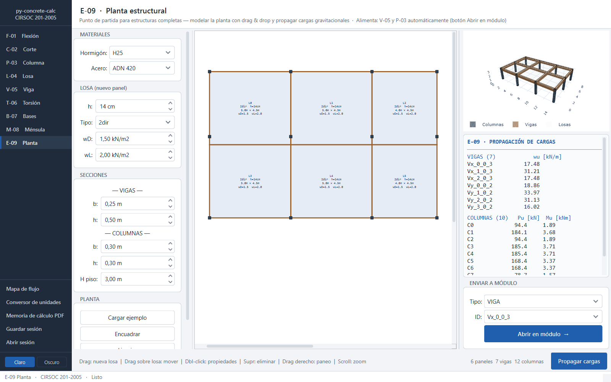
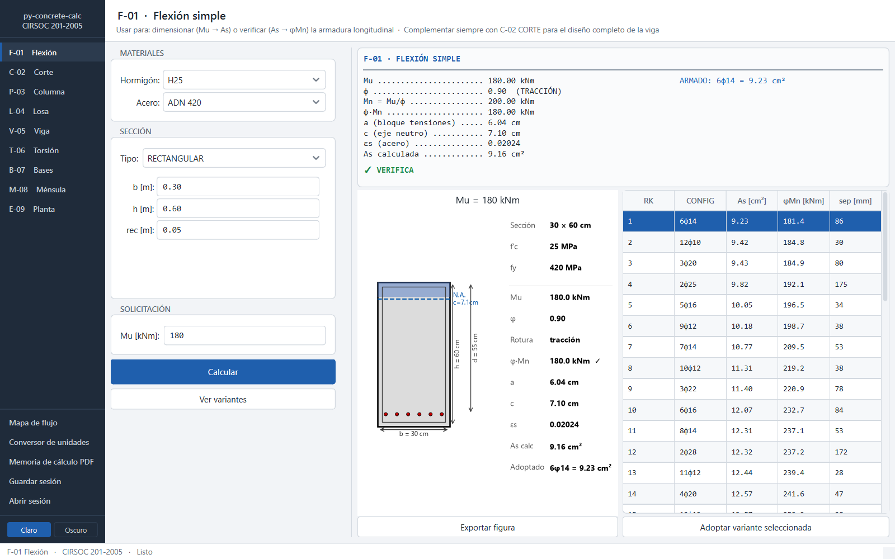
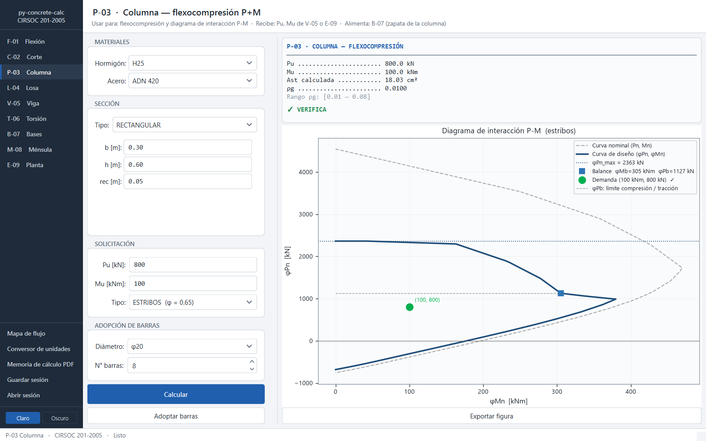
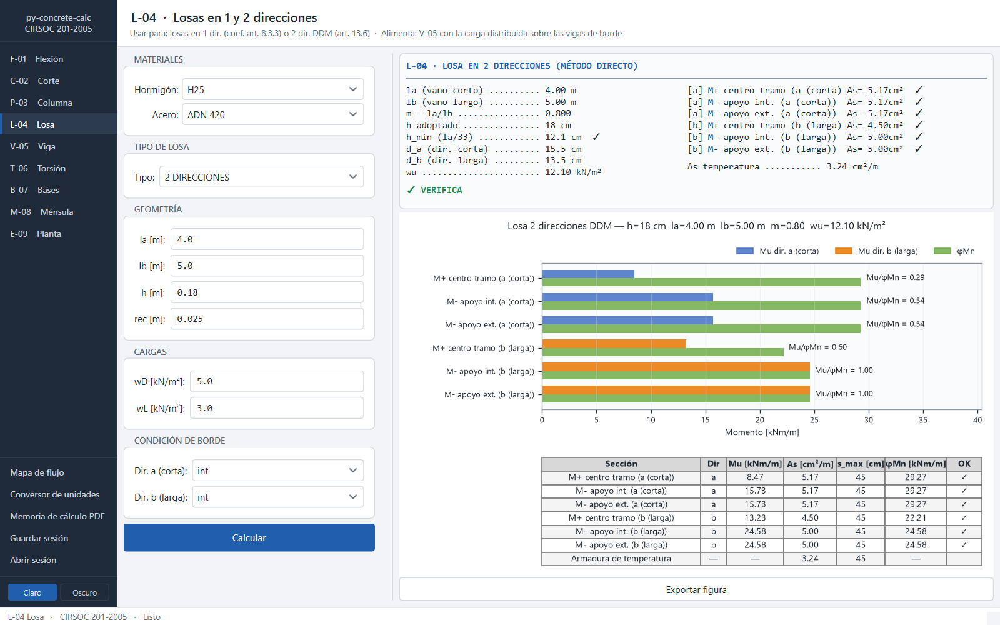
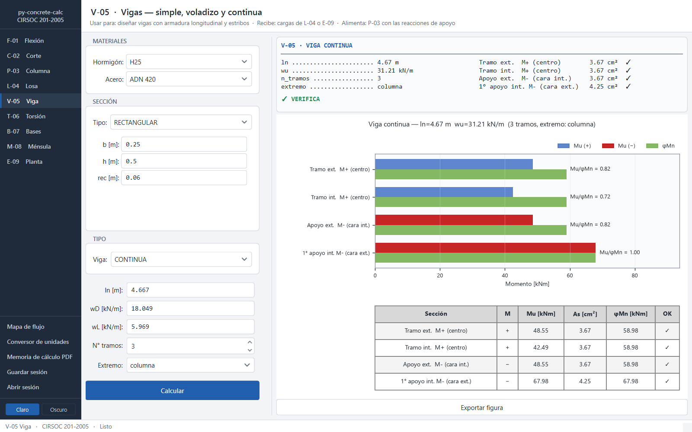
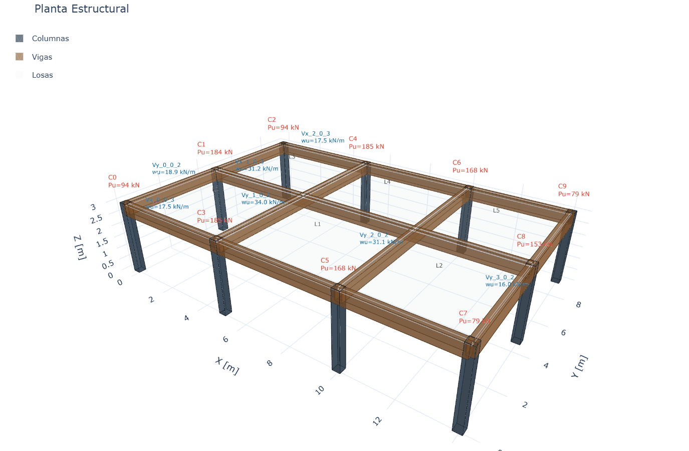
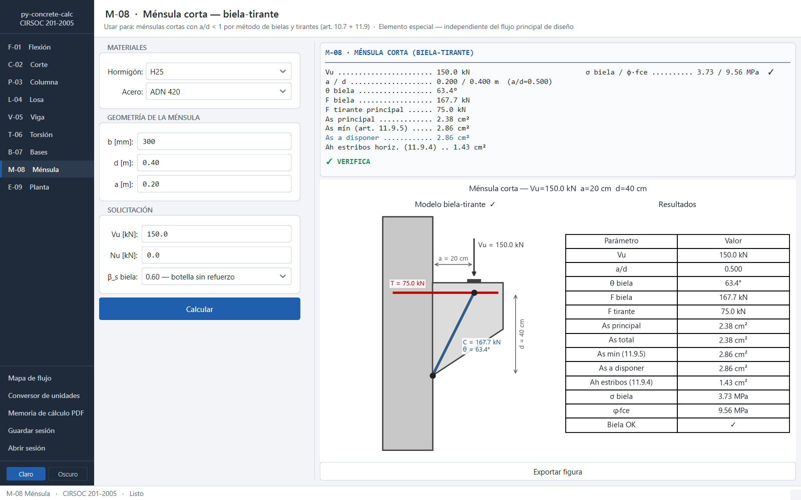
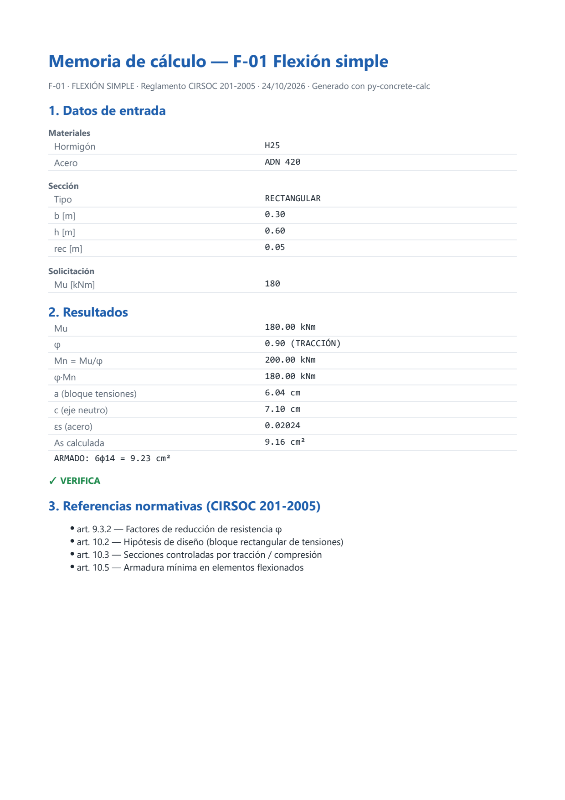
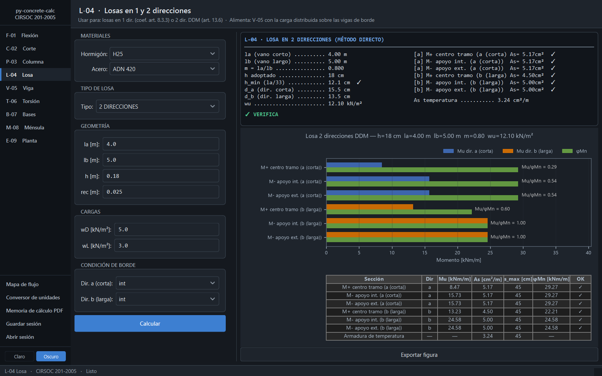

# py-concrete-calc

[](https://github.com/federicoarielcasado/py-concrete-calc/actions/workflows/tests.yml)

**py-concrete-calc** es una librería Python y aplicación de escritorio para el diseño y verificación de elementos de hormigón armado según **CIRSOC 201-2005** (equivalente argentino del ACI 318).

Cubre el programa de Estructuras de Hormigón de UTN FRA: materiales, secciones y combinaciones de cargas, flexión, corte, torsión, columnas, losas, bases, anclajes, tirantes y modelos biela-tirante. La librería de cálculo funciona 100 % offline y puede usarse sola (scripts, tests, notebooks) o a través de la aplicación de escritorio PyQt6.



## Características principales

- **Aplicación de escritorio con 9 módulos de cálculo**, desde el modelo de planta hasta el detalle de cada sección.
- **Flujo de diseño integrado**: se dibuja la planta (drag & drop), se propagan las cargas y cada viga o columna se abre en su módulo con los datos precargados.
- **Visualización 3D interactiva** del modelo (Plotly embebido, sin conexión a internet).
- **Memoria de cálculo en PDF** de cada módulo: datos de entrada, resultados, referencias al CIRSOC y figura.
- **Validación de datos** antes de calcular, con el campo inválido resaltado y un mensaje claro.
- **Temas claro y oscuro**, aplicados también a los gráficos y al modelo 3D.
- **Sistema de variantes**: las funciones de dimensionado devuelven todas las combinaciones de armadura comercial válidas, ordenadas por menor peso de acero.
- **Trazabilidad total**: cada resultado guarda todos los valores intermedios (As, φMn, Vc, At/s, etc.).
- **594 tests automatizados**, validados contra los ejemplos resueltos del CIRSOC con tolerancia ≤ 1 %.
- **Arquitectura en capas**: la librería de cálculo no depende de la interfaz gráfica.

## Capturas

| | |
|---|---|
|  **F-01 Flexión**: dimensionado de As, variantes de armado y sección con barras adoptadas |  **P-03 Columna**: diagrama de interacción P-M con φ variable |
|  **L-04 Losa**: 2 direcciones por Método Directo (art. 13.6) |  **V-05 Viga continua**: cargas recibidas desde la planta (E-09) |
|  **E-09 Modelo 3D**: vigas, columnas y cargas propagadas |  **M-08 Ménsula corta**: modelo biela-tirante |
|  **Memoria de cálculo** exportada a PDF |  **Tema oscuro** |

## Módulos de la aplicación

| Código | Módulo | Contenido |
|---|---|---|
| E-09 | Planta | Editor visual de planta, propagación de cargas a vigas y columnas, vista 3D |
| L-04 | Losa | 1 dirección (coeficientes, art. 8.3.3) y 2 direcciones (Método Directo, art. 13.6) |
| V-05 | Viga | Simple, voladizo y continua: diagramas M/V, armadura longitudinal y estribos |
| P-03 | Columna | Flexocompresión, diagrama de interacción P-M, estribadas y zunchadas |
| F-01 | Flexión | Dimensionado (Mu → As) y verificación (As → φMn), armadura simple y doble |
| C-02 | Corte | Vc, Vs, estribado mínimo y separación máxima (art. 11.5) |
| T-06 | Torsión | Torsión combinada con corte, At/s y Al (art. 11.6) |
| B-07 | Bases | Zapata aislada centrada: suelo, punzonamiento, corte y flexión (cap. 15) |
| M-08 | Ménsula | Ménsula corta por biela-tirante, cuantía mínima y estribos horizontales (art. 11.9) |

Además: memoria de cálculo en PDF, conversor de unidades (kgf, tf, kgf/cm² ↔ kN, MPa…), mapa de flujo de diseño, guardar/abrir sesión en JSON, exportación de figuras (PDF/PNG/SVG) y temas claro y oscuro.

## Librería de cálculo (`hormigon/`)

| Módulo | Contenido |
|---|---|
| `materiales.py` | `Hormigon` y `Acero` con propiedades derivadas (β₁, f\*c, Ec, Es) |
| `secciones.py` | Secciones rectangular, T, L y circular; ancho efectivo de alas (art. 8.10) |
| `cargas.py` | Combinaciones de acciones art. 9.2.1; método de los coeficientes art. 8.3.3 |
| `flexion.py` | Flexión simple: dimensionado y verificación; armadura simple y doble; φ según modo de rotura |
| `corte.py` | Vc, Vs, estribado y envolvente φVn |
| `torsion.py` | Torsión combinada con corte; armadura transversal At/s y longitudinal Al (art. 11.6) |
| `columnas.py` | Columnas cortas estribadas y zunchadas; diagrama de interacción P-M |
| `losas.py` | Losas en 1 dirección (coeficientes) y 2 direcciones (Método Directo) |
| `bases.py` | Bases aisladas centradas; flexión, corte unidireccional y punzonamiento (art. 15) |
| `tirantes.py` | Elementos en tracción pura; control de fisuras (art. 10.6.4) |
| `anclajes.py` | Longitudes de desarrollo y empalme en tracción y compresión; ganchos (art. 12) |
| `bielas.py` | Método biela-tirante (art. 10.7); eficiencia de bielas y nudos; ménsulas cortas |
| `modelo.py`, `propagacion.py` | Modelo de planta (grilla, losas, vigas, columnas) y bajada de cargas |

## Instalación

Requiere Python 3.12+.

```bash
git clone https://github.com/federicoarielcasado/py-concrete-calc.git
cd py-concrete-calc
python -m venv .venv && .venv\Scripts\activate   # Windows
pip install -r requirements.txt
```

## Uso

### Aplicación de escritorio

```bash
python app/main.py
```

El módulo E-09 abre con una planta de ejemplo: **Propagar cargas** calcula las cargas sobre vigas y columnas, y **Abrir en módulo** lleva cada elemento a V-05 o P-03 con los datos cargados. Desde la barra lateral, **Memoria de cálculo PDF** exporta el informe del módulo activo.

### Como librería

```python
from hormigon.materiales import Hormigon, Acero
from hormigon.secciones import SeccionRectangular
from hormigon.flexion import dimensionar_flexion, dimensionar_flexion_variantes

h25  = Hormigon(fc=25)
a420 = Acero(fy=420)
sec  = SeccionRectangular(b=0.30, h=0.60, recubrimiento=0.04, hormigon=h25, acero=a420)

# Solución única
resultado = dimensionar_flexion(seccion=sec, Mu=180)
print(resultado.As)       # cm²
print(resultado.phi_Mn)   # kNm

# Todas las combinaciones válidas, rankeadas por menor área de acero
rset = dimensionar_flexion_variantes(seccion=sec, Mu=180)
rset.mostrar()
```

### Ejemplos

La carpeta `ejemplos/` replica ejemplos resueltos del CIRSOC. Se ejecutan desde la raíz del proyecto:

```bash
python -m ejemplos.ej_viga_continua
```

## Tests

```bash
python -m pytest
```

594 tests cubren los módulos de cálculo, los elementos tipificados, la propagación de cargas y los gráficos. Se ejecutan automáticamente en GitHub Actions en cada push.

## Stack tecnológico

| Capa | Tecnología |
|---|---|
| Librería de cálculo | Python 3.12, NumPy, SciPy |
| Interfaz de escritorio | PyQt6, Matplotlib (embebido), Plotly 3D (QWebEngineView) |
| Tests | pytest |

## Estructura del proyecto

```
hormigon/       # Librería de cálculo, sin dependencia de la UI
elementos/      # Elementos tipificados: viga, columna, losa, planta
graficos/       # Visualización: secciones 2D, diagramas, modelo 3D
app/            # Aplicación de escritorio PyQt6 (ventanas y widgets)
tests/          # Tests unitarios por módulo
ejemplos/       # Scripts que replican los ejemplos resueltos del CIRSOC
docs/capturas/  # Capturas de la aplicación
```

## Próximos pasos

- Columnas esbeltas: amplificación de momentos (art. 10.10–10.12).
- Secciones circulares en columnas y diagrama de interacción.
- Bases medianeras y de esquina.
- Losas en 2 direcciones por Pórtico Equivalente (art. 13.7) y punzonamiento en losas sin vigas.
- Pantallas en la aplicación para anclajes y tirantes (ya disponibles en la librería).

**Autor**: Federico Ariel Casado (UTN FRA)  
**Reglamento**: CIRSOC 201-2005  
**Licencia**: Privada
